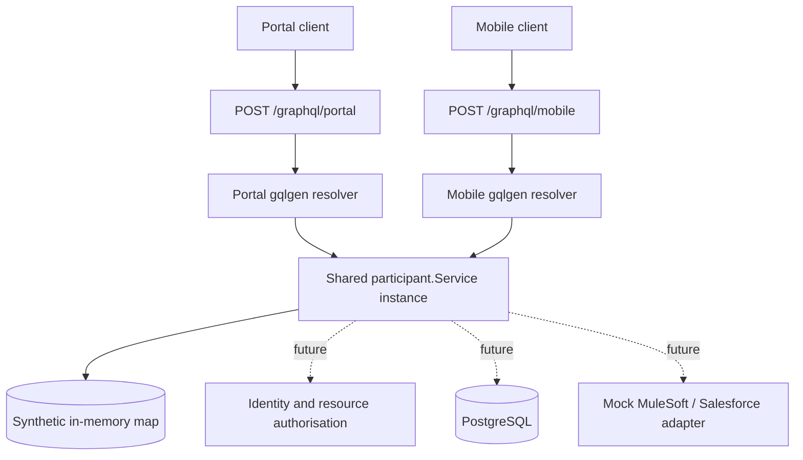
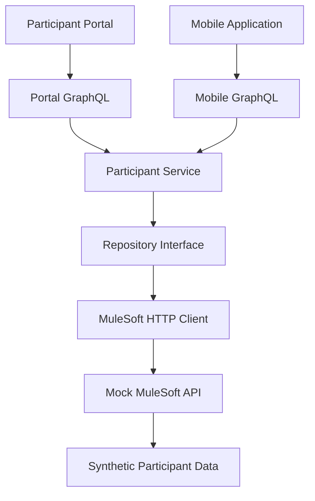

# Participant Services — Technical Design

> **Status: implemented local baseline plus planned architecture, 27 October 2026.** Portal and Mobile GraphQL endpoints have both returned expected synthetic participant data through a shared Go service. Service unit tests and Portal HTTP integration tests passed, including race-enabled runs before final Mobile route wiring. Mobile HTTP integration testing, authorisation, external integrations and cloud deployment are pending. This is a synthetic interview lab, not an NDIA system.

<details>
<summary>1. Purpose and scope</summary>

Practise designing and troubleshooting a Go middleware platform serving a Participant Portal and Mobile App, with GraphQL consumer APIs, shared services, simulated enterprise integrations and eventual AWS EKS deployment. Key interview themes: hands-on Go, GraphQL, security, platform engineering, production debugging and technical leadership.

</details>

<details>
<summary>2. As-built architecture and planned extensions</summary>



**Implemented routes:** `GET /healthz`, `POST /graphql/portal`, `POST /graphql/mobile`, `GET /playground/portal`, `GET /playground/mobile`. The Playground routes are development-only. **Planned:** `/readyz`, authentication, observability, persistence and integration adapters. The legacy Todo `server.go` remains a separate scaffold.

The server constructs **one** `participant.NewService()` and injects it into both GraphQL resolvers. Two distinct gqlgen configurations (`gqlgen.portal.yml`, `gqlgen.mobile.yml`) generate separate executable schemas and models. Import aliases `portalgenerated` and `mobilegenerated` prevent package-name collisions.

</details>

<details>
<summary>3. Actual GraphQL contracts</summary>

**Portal** (`graph/portal/schema.graphqls`):

```graphql
type Participant {
  id: ID!
  firstName: String!
  lastName: String!
}
type Query {
  participant(id: ID!): Participant
}
```

**Mobile** (`graph/mobile/schema.graphqls`):

```graphql
type ParticipantProfile {
  participantId: ID!
  displayName: String!
}
type Query {
  profile(participantId: ID!): ParticipantProfile
}
```

| Concern | Portal (implemented) | Mobile (implemented) | Future |
|---|---|---|---|
| Read participant | `participant(id:)` | `profile(participantId:)` | Authenticated identity and ownership checks |
| Name fields | `firstName`, `lastName` | Combined `displayName` | Field-level access policy |
| Missing ID | Nullable `null` | Nullable `null` | Consistent error and audit policy |
| Data | Shared in-memory fixture | Same service instance | PostgreSQL and enterprise systems |
| Plans/submissions | Not implemented | Not implemented | Plans, submissions, idempotency |

**Security gap:** both APIs currently accept caller-provided participant IDs without authentication or authorisation. They must remain local development endpoints with synthetic data.

</details>

<details>
<summary>4. Representative request flows</summary>

### Read participant information

1. Authenticate caller and validate token issuer, audience, expiry and signature.
2. Derive identity and scopes from trusted claims.
3. Parse GraphQL operation and enforce depth/complexity and pagination limits.
4. Resolver calls shared service with request `context.Context`.
5. Service enforces resource-level authorisation before reading data.
6. Use request-scoped batching to prevent N+1 downstream calls.
7. Return only fields permitted by the consumer schema and caller.

### Submit a plan-related request

1. Validate input and authenticated participant identity.
2. Require an idempotency key and persist a submission record/unique constraint.
3. Call the simulated MuleSoft adapter with bounded timeout and correlation ID.
4. On timeout/5xx, preserve an unambiguous pending state; retry only when safe.
5. Reconcile eventual outcomes without creating duplicate submissions.
6. Return a stable submission identifier and status to clients.

</details>

<details>
<summary>5. Go design and resilience</summary>

- `context.Context` flows from HTTP handler through resolver, service and downstream HTTP/database calls; honor cancellation and deadlines.
- Bound goroutines, outbound concurrency and connection pools. Use `errgroup` or worker pools where parallel work is justified; avoid fire-and-forget goroutines tied to requests.
- Prefer typed/sentinel errors at service boundaries, with safe GraphQL error translation; never leak internal stack traces or sensitive data.
- Retry transient downstream failures with exponential backoff, jitter and a retry budget; do not retry non-idempotent mutations blindly.
- Use structured logs, request IDs, metrics, traces and latency/error SLOs; test graceful shutdown and resource cleanup.
- The implemented `participant.Service` uses `sync.RWMutex` for map access, checks `ctx.Err()` before reading, and returns `ErrNotFound` for absent IDs. All four service tests passed, including 100 concurrent readers; no write path or authorisation exists yet.

</details>

<details>
<summary>6. Persistence and integration</summary>

**Planned PostgreSQL entities:** `participants`, `plans`, `submissions`, and `submission_events` (exact columns and constraints to be designed). Use migrations, transaction boundaries, indexed lookup paths and parameterised queries. Avoid storing sensitive data in logs.

**Simulated integration:** Go adapter → mock MuleSoft → mock Salesforce, with configurable success, latency, 429/500/503, connection failures and duplicate requests. Mocks must use synthetic records only. Keep integration DTOs separate from GraphQL and domain models.

</details>

<details>
<summary>7. AWS/EKS deployment (planned)</summary>

```text
Client -> controlled edge / ingress -> EKS Go API pods
                                     |-> managed PostgreSQL (RDS)
                                     |-> mock integration service
                                     |-> CloudWatch / telemetry backend
```

Define Docker image, Kubernetes Deployment/Service/Ingress, CPU/memory requests and limits, liveness/readiness probes, rolling updates and autoscaling. Prefer workload identity/IAM roles over static AWS keys; store secrets in a managed secret store; restrict networking and database access. ECR and EKS deployment is **not yet performed**. Cloudflare Zero Trust/Access/Tunnels may be studied as an optional security layer, not assumed to be present.

</details>

<details>
<summary>8. Verification matrix and failure drills</summary>

| Layer | Verified | Remaining |
|---|---|---|
| Todo scaffold | `TestCreateTodo` passed; race-enabled suite passed | Retire scaffold after migration |
| Participant Service | Lookup, missing ID, cancelled context, 100 concurrent reads; `-race` passed | Concurrent writes, timeouts, authorisation |
| Portal GraphQL | `httptest` integration test passed; live `curl` returned P001 | Negative cases, identity checks |
| Mobile GraphQL | Resolver compiled; live `curl` returned P001 profile | Run proposed Mobile HTTP integration test |
| Full Go build | Both generated packages compiled before final HTTP wiring | Confirm final `go test ./...` and `-race` after both routes registered |
| Git | Portal milestone previously committed; Mobile files were untracked at last status | Confirm Mobile commit and push |
| Enterprise / deployment | Not implemented | Integration failure drills, N+1, Docker/EKS, CI/CD |

**Observed live responses:** Portal returned `{ "id":"P001", "firstName":"Alex", "lastName":"Taylor" }`; Mobile returned `{ "participantId":"P001", "displayName":"Alex Taylor" }` under the `data` object. These verify local endpoint behavior, not production readiness.

</details>

<details>
<summary>9. Architectural decisions (proposed)</summary>

<details>
<summary><strong>ADR-001: Separate GraphQL contracts per consumer</strong></summary>

**Decision:** Separate portal and mobile gqlgen packages and schemas, sharing domain services. **Reason:** distinct client needs, independent schema evolution, least data exposure. **Trade-off:** two schema build pipelines and duplicated API-level wiring. **Status:** implemented for schema separation and service reuse; independent schema evolution remains to be tested.

</details>

<details>
<summary><strong>ADR-002: Shared services enforce authorisation</strong></summary>

**Decision:** Keep authorisation and business rules in shared services, not exclusively in GraphQL resolvers. **Reason:** prevents inconsistent rules across channels. **Trade-off:** service APIs must receive explicit identity context. **Status:** proposed.

</details>

<details>
<summary><strong>ADR-003: Explicit integration adapter with idempotency</strong></summary>

**Decision:** Isolate MuleSoft/Salesforce behind an adapter and persist submission identity/state. **Reason:** testable failure handling and safe retries. **Trade-off:** reconciliation and state transitions add complexity. **Status:** proposed.

</details>

<details>
<summary><strong>ADR-004: EKS as a deployment exercise, not an initial prerequisite</strong></summary>

**Decision:** Validate local Go/GraphQL and Docker/Kubernetes first, then deploy to EKS if time/cost permit. **Reason:** interview preparation prioritises working code and diagnosis over infrastructure spend. **Status:** proposed.

</details>

</details>

<details>
<summary>10. Team engineering practices</summary>

Establish PR review requirements, schema compatibility checks, threat modelling for participant data, automated tests, race checks, dependency/security scanning, documented incident playbooks and rollback criteria. AI-generated code is treated as an untrusted draft requiring human review, particularly for authorisation, error handling and resource leaks.

</details>

<details>
<summary>11. Immediate next milestone</summary>

1. Create/verify `graph/mobile/integration_test.go`; run `go test -v ./graph/mobile` and `go test -race ./...` after both routes are wired.
2. Commit and push `cmd/api/main.go`, `gqlgen.mobile.yml`, `graph/mobile/`; confirm clean `git status`.
3. Add request identity and enforce participant-level authorisation in the shared service; prevent cross-participant access from both APIs.
4. Introduce a mock MuleSoft integration with cancellation, timeouts, structured errors and idempotency; write failure tests.
5. Demonstrate GraphQL N+1 and batching; then Docker, observability, Kubernetes and EKS.

</details>

<details>
<summary>12. Developer commands and operational notes</summary>

```bash
go tool gqlgen generate --config gqlgen.portal.yml
go tool gqlgen generate --config gqlgen.mobile.yml
gofmt -w cmd/api/main.go
go test ./...
go test -race ./...
go run ./cmd/api
```

```bash
curl -sS http://localhost:8080/graphql/portal \
  -H 'Content-Type: application/json' \
  -d '{"query":"{ participant(id: \"P001\") { id firstName lastName } }"}'

curl -sS http://localhost:8080/graphql/mobile \
  -H 'Content-Type: application/json' \
  -d '{"query":"{ profile(participantId: \"P001\") { participantId displayName } }"}'
```

Do not use live participant data. Keep Playground and unauthenticated endpoints local only. Both generated packages are named `generated`; use explicit Go import aliases. Do not edit gqlgen-generated source manually; change schema/config/resolvers and regenerate.

</details>

<details>
<summary>13. Implemented enterprise middleware integration</summary>

**Status:** Implemented and verified locally on 27 October 2026.

### 13.1 Architecture

The Portal and Mobile GraphQL APIs share a Participant Service that retrieves data through a repository interface and MuleSoft HTTP client.



### 13.2 Component responsibilities

| Component | Responsibility |
|---|---|
| Portal GraphQL | Portal-specific participant schema |
| Mobile GraphQL | Mobile-specific profile schema |
| Participant Service | Shared application service |
| Repository interface | Dependency inversion and data access contract |
| MuleSoft HTTP client | External HTTP integration |
| Mock MuleSoft API | Simulated enterprise backend |
| Synthetic data | Test participant records |

### 13.3 Dependency injection

The Participant Service supports an injected repository through `NewServiceWithRepository(repository)`.

The MuleSoft HTTP client implements `participant.Repository`.

The original `NewService()` constructor remains available for in-memory tests.

### 13.4 HTTP resilience

Implemented:

- Configurable HTTP client timeout.
- Request context propagation and cancellation.
- HTTP 404 mapped to the domain not-found error.
- HTTP 5xx mapped to an upstream error.
- Network failure propagation.
- JSON response decoding.

Planned:

- Bounded retries with exponential backoff.
- Circuit breaking.
- Authentication and authorisation.
- Structured logging, metrics and distributed tracing.
- Production-grade readiness checks.

### 13.5 Runtime configuration

- GraphQL API: `localhost:8080`
- Mock MuleSoft API: `localhost:8081`
- Upstream configuration: `MULESOFT_URL`

### 13.6 Verification

The following tests passed:

- Participant Service unit tests.
- Repository dependency injection tests.
- Mock MuleSoft HTTP handler tests.
- MuleSoft HTTP client tests.
- Portal and Mobile GraphQL integration tests.
- Automated GraphQL-to-MuleSoft end-to-end tests.

The full `go test -race ./...` suite passed on 27 October 2026.

### 13.7 Architectural trade-offs

The Participant Service currently supports both in-memory data and an injected repository. This preserves compatibility but mixes two data-access strategies.

A future refactor should move the in-memory implementation into a dedicated repository adapter.

The MuleSoft API is simulated. No actual NDIA, MuleSoft or Salesforce systems are connected.

### 13.8 Bounded retries and exponential backoff

**Status:** Implemented and verified locally on 27 October 2026.

The MuleSoft HTTP client supports three total GET attempts, with retry delays derived from the named constant `initialRetryDelay` (100 ms followed by 200 ms).

- Retry HTTP 502, 503 and 504, plus eligible network failures.
- Do not retry HTTP 404, other non-retryable responses or client timeout errors.
- Stop when the request context is cancelled, including during backoff.
- Preserve the shared Participant Service and existing GraphQL schemas.

Automated tests verify recovery after transient failures, the maximum attempt count, no retry for HTTP 404, and cancellation during backoff.

**Verification:** `go test -count=1 -race ./...` passed.

**Production improvements planned:** jitter, `Retry-After` handling, an overall retry budget, configurable policies and retry metrics.

</details>

<details>
<summary>14. Production-grade HTTP server lifecycle</summary>

### 14.1 Server configuration

The Participant Services API uses Go's `net/http` server with explicit timeouts:

| Setting | Value | Purpose |
|---|---|---|
| ReadHeaderTimeout | 5 seconds | Limits time spent receiving HTTP headers |
| ReadTimeout | 10 seconds | Limits time spent reading the complete request |
| WriteTimeout | 15 seconds | Bounds response writing time |
| IdleTimeout | 60 seconds | Limits idle keep-alive connections |
| Shutdown timeout | 10 seconds | Bounds graceful shutdown |

These settings provide baseline protection against stalled connections and unbounded shutdown.

### 14.2 Liveness and readiness

The API exposes two separate health endpoints:

- `GET /healthz` returns HTTP 200 while the HTTP server is operating.
- `GET /readyz` returns HTTP 200 when the application is ready and HTTP 503 when readiness is disabled.

Readiness is implemented in `internal/health` using `atomic.Bool`, allowing safe concurrent access from HTTP handlers and the shutdown goroutine.

The current readiness check reflects application lifecycle state. It does not actively test MuleSoft or other external dependencies.

### 14.3 Graceful shutdown

The API listens for SIGINT and SIGTERM using `signal.NotifyContext`.

On receiving a shutdown signal:

1. The application marks itself not ready.
2. It creates a shutdown context with a 10-second deadline.
3. It calls `http.Server.Shutdown`.
4. The HTTP server stops accepting new connections and waits for active requests to complete.
5. The application exits when shutdown finishes or reports an error if the deadline is exceeded.

The application does not currently include a pre-shutdown delay for Kubernetes endpoint propagation.

### 14.4 Automated verification

Tests cover:

- Initial readiness returning HTTP 200.
- Disabled readiness returning HTTP 503.
- Concurrent readiness reads and writes under Go's race detector.
- An active HTTP request completing while `http.Server.Shutdown` is running.

The complete repository has passed:

- `go test -count=1 -race ./...`
- `go vet ./...`
- `git diff --check`

### 14.5 AWS EKS considerations

A future Kubernetes deployment should define:

- A readiness probe using `/readyz`.
- A liveness probe using `/healthz`.
- A suitable `terminationGracePeriodSeconds`.
- A traffic-draining strategy that accounts for Kubernetes Service and load-balancer propagation.
- Resource requests and limits.

The current implementation demonstrates application-level shutdown behaviour. End-to-end Kubernetes termination and traffic draining remain to be implemented and verified.

</details>
