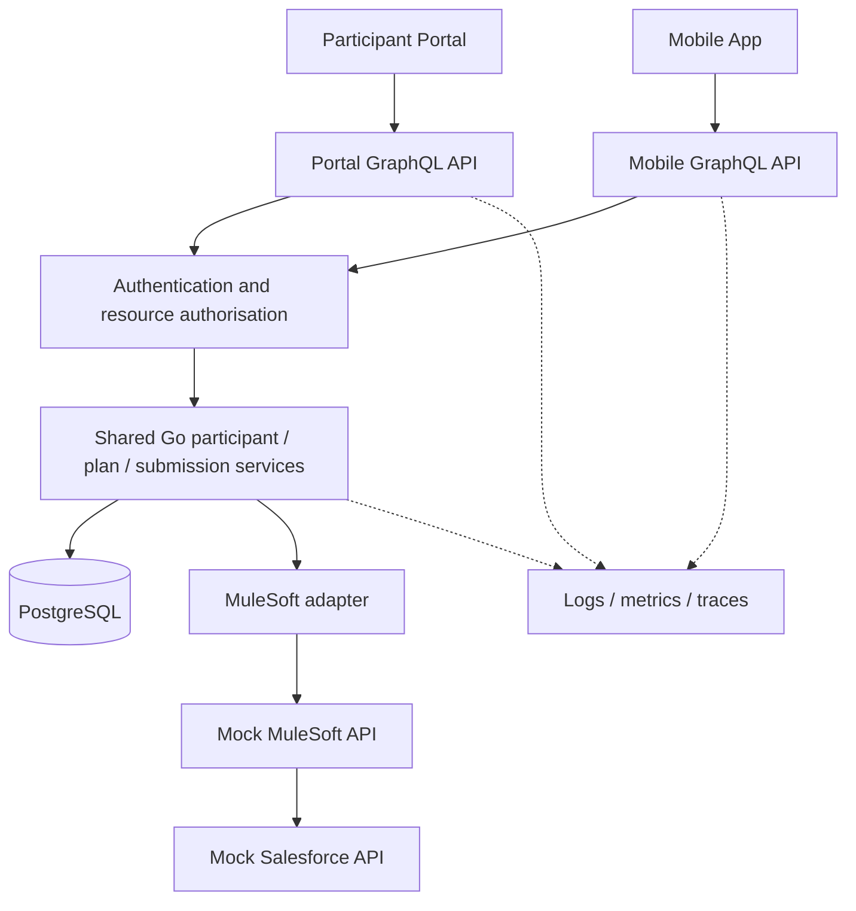

# Participant Services — Technical Design

> **Status: proposed architecture, 27 October 2026.** The only verified runtime components so far are the Go `/healthz` endpoint and the gqlgen Todo example. This is a synthetic interview lab, not an NDIA system.

## 1. Purpose and scope

Practise designing and troubleshooting a Go middleware platform serving a Participant Portal and Mobile App, with GraphQL consumer APIs, shared services, simulated enterprise integrations and eventual AWS EKS deployment. Key interview themes: hands-on Go, GraphQL, security, platform engineering, production debugging and technical leadership.

## 2. Context and component architecture



**Planned HTTP routes:** `GET /healthz`, `GET /readyz`, `POST /graphql/portal`, `POST /graphql/mobile`. The first route exists; the others are planned. The existing generated `server.go` is a temporary Todo demo, not the final server.

## 3. Contract boundaries

| Concern | Portal schema | Mobile schema | Shared service |
|---|---|---|---|
| Participant access | `participant(id: ID!)`, authorised listing | `me` from verified identity | Identity-scoped participant lookup |
| Plans | Plan history and detail | Current plan summary | Plan rules and persistence |
| Submissions | Submission history and status | Submit action and status | Idempotency, validation, integration |
| Evolution | Independently versioned/deprecated fields | Minimal client-compatible fields | Stable domain operations |

Use **two separate gqlgen configurations and generated Go packages** to keep contracts independent. Both resolver sets inject the same service interfaces. Never trust a client-provided participant ID to grant access; enforce ownership/permissions in the service layer. This is a design proposal, not yet implemented.

## 4. Representative request flows

### Read participant information

1. Authenticate caller and validate token issuer, audience, expiry and signature.
2. Derive identity and scopes from trusted claims.
3. Parse GraphQL operation and enforce depth/complexity and pagination limits.
4. Resolver calls shared service with request `context.Context`.
5. Service enforces resource-level authorisation before reading data.
6. Use request-scoped batching to prevent N+1 downstream calls.
7. Return only fields permitted by the consumer schema and caller.

### Submit a plan-related request

1. Validate input and authenticated participant identity.
2. Require an idempotency key and persist a submission record/unique constraint.
3. Call the simulated MuleSoft adapter with bounded timeout and correlation ID.
4. On timeout/5xx, preserve an unambiguous pending state; retry only when safe.
5. Reconcile eventual outcomes without creating duplicate submissions.
6. Return a stable submission identifier and status to clients.

## 5. Go design and resilience

- `context.Context` flows from HTTP handler through resolver, service and downstream HTTP/database calls; honor cancellation and deadlines.
- Bound goroutines, outbound concurrency and connection pools. Use `errgroup` or worker pools where parallel work is justified; avoid fire-and-forget goroutines tied to requests.
- Prefer typed/sentinel errors at service boundaries, with safe GraphQL error translation; never leak internal stack traces or sensitive data.
- Retry transient downstream failures with exponential backoff, jitter and a retry budget; do not retry non-idempotent mutations blindly.
- Use structured logs, request IDs, metrics, traces and latency/error SLOs; test graceful shutdown and resource cleanup.
- The proposed in-memory `participant.Service` uses `sync.RWMutex` for map access and checks `ctx.Err()` before reading. It is **not yet verified** and does not yet implement authorisation.

## 6. Persistence and integration

**Planned PostgreSQL entities:** `participants`, `plans`, `submissions`, and `submission_events` (exact columns and constraints to be designed). Use migrations, transaction boundaries, indexed lookup paths and parameterised queries. Avoid storing sensitive data in logs.

**Simulated integration:** Go adapter → mock MuleSoft → mock Salesforce, with configurable success, latency, 429/500/503, connection failures and duplicate requests. Mocks must use synthetic records only. Keep integration DTOs separate from GraphQL and domain models.

## 7. AWS/EKS deployment (planned)

```text
Client -> controlled edge / ingress -> EKS Go API pods
                                     |-> managed PostgreSQL (RDS)
                                     |-> mock integration service
                                     |-> CloudWatch / telemetry backend
```

Define Docker image, Kubernetes Deployment/Service/Ingress, CPU/memory requests and limits, liveness/readiness probes, rolling updates and autoscaling. Prefer workload identity/IAM roles over static AWS keys; store secrets in a managed secret store; restrict networking and database access. ECR and EKS deployment is **not yet performed**. Cloudflare Zero Trust/Access/Tunnels may be studied as an optional security layer, not assumed to be present.

## 8. Testing and failure drills

| Layer | Planned verification |
|---|---|
| Resolver | Contract queries/mutations, errors and access control |
| Service | Not-found, cancellation, authorisation, concurrent calls (`-race`) |
| Integration | Timeout, retry/backoff, idempotency and reconciliation |
| Performance | N+1 reproduction, batching, pagination, load and p95 latency |
| Kubernetes | Readiness, OOMKilled, restart investigation and rollback |
| Delivery | GitHub Actions build/test/race/static checks and deployment gates |

**Verified today:** `TestCreateTodo` passed under normal and race-enabled test runs. This test is sequential and does not prove concurrent safety. No participant service, integration, load or Kubernetes tests have yet been reported.

## 9. Architectural decisions (proposed)

<details>
<summary><strong>ADR-001: Separate GraphQL contracts per consumer</strong></summary>

**Decision:** Separate portal and mobile gqlgen packages and schemas, sharing domain services. **Reason:** distinct client needs, independent schema evolution, least data exposure. **Trade-off:** two schema build pipelines and duplicated API-level wiring. **Status:** proposed.

</details>

<details>
<summary><strong>ADR-002: Shared services enforce authorisation</strong></summary>

**Decision:** Keep authorisation and business rules in shared services, not exclusively in GraphQL resolvers. **Reason:** prevents inconsistent rules across channels. **Trade-off:** service APIs must receive explicit identity context. **Status:** proposed.

</details>

<details>
<summary><strong>ADR-003: Explicit integration adapter with idempotency</strong></summary>

**Decision:** Isolate MuleSoft/Salesforce behind an adapter and persist submission identity/state. **Reason:** testable failure handling and safe retries. **Trade-off:** reconciliation and state transitions add complexity. **Status:** proposed.

</details>

<details>
<summary><strong>ADR-004: EKS as a deployment exercise, not an initial prerequisite</strong></summary>

**Decision:** Validate local Go/GraphQL and Docker/Kubernetes first, then deploy to EKS if time/cost permit. **Reason:** interview preparation prioritises working code and diagnosis over infrastructure spend. **Status:** proposed.

</details>

## 10. Team engineering practices

Establish PR review requirements, schema compatibility checks, threat modelling for participant data, automated tests, race checks, dependency/security scanning, documented incident playbooks and rollback criteria. AI-generated code is treated as an untrusted draft requiring human review, particularly for authorisation, error handling and resource leaks.

## 11. Immediate next milestone

1. Commit the passing Todo unit test if not already committed.
2. Add and verify `internal/participant/service.go` and tests for not-found, cancellation and concurrent reads.
3. Generate the Portal schema, then Mobile schema, with distinct gqlgen configs and a shared injected service.
4. Consolidate HTTP routes in `cmd/api/main.go`; retire the temporary generated `server.go` when ready.
