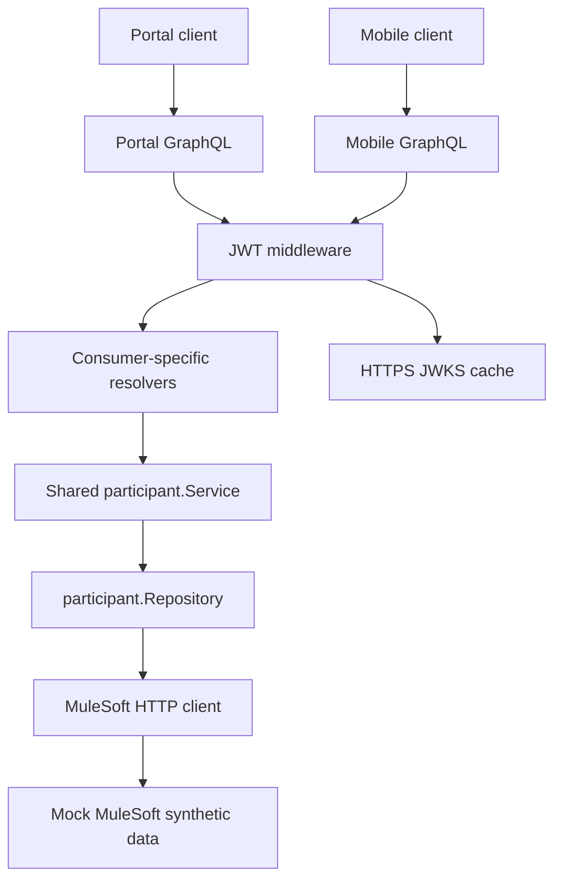

# Participant Services — Architecture overview

[Documentation index](docs/README.md) · [Development journal](docs/development-journal.md)

**As built — 29 October 2026:** local synthetic middleware prototype, including JWT authentication committed as `4a4bec9`. Verification evidence is recorded in [testing](docs/testing.md). A [local Kubernetes demonstration](docs/kubernetes.md) now packages the same three services with internal Services, configuration and certificate mounts. The [AWS identity/secrets design](docs/aws-identity-secrets.md) separates end-user authentication from workload permissions; no cloud deployment is claimed.

Request ID and access-log middleware wrap the router. Health probes remain public; Playground pages are development tools. The runtime constructs one service with an injected MuleSoft repository for both consumer resolvers. The in-memory constructor remains available for tests. The legacy Todo `server.go` is a separate scaffold and does not establish the participant API's security behaviour.

Boundaries and request flow — implemented

HTTP requests receive a correlation ID and access logging. Portal and Mobile POST routes validate a Bearer JWT before invoking their separate gqlgen schemas. Validated claims enter the request context. Resolvers pass that context to the shared service and repository adapter; the HTTP client propagates cancellation and request correlation to mock MuleSoft. Consumer models remain distinct from domain and integration models.

Authentication establishes identity; the shared service now enforces [self-access](docs/authorisation.md) using a verified issuer-managed participant mapping before repository access. Query complexity limits, batching, persistence, submissions and idempotency are future work.

Detailed behaviour belongs in [authentication](docs/authentication.md), [GraphQL](docs/graphql.md), [integration](docs/integration.md), [observability](docs/observability.md), and [health/lifecycle](docs/health-lifecycle.md).

Architecture decisions and trade-offs

- **ADR-001 — implemented:** separate Portal and Mobile gqlgen schemas and models share domain services. This supports distinct consumer needs and least data exposure, at the cost of two generation configurations and duplicated API wiring. Independent schema evolution remains to be tested.
- **ADR-002 — implemented for self-access:** enforce participant identity matching in shared services using trusted context, so both channels use the same rule. Staff/delegate policies remain proposed.
- **ADR-003 — partially implemented:** isolate enterprise integration behind a repository adapter. The adapter exists; persistent submission identity, idempotency and reconciliation are proposed. They add state-management complexity but enable safe mutation retries.
- **ADR-004 — proposed deployment approach:** validate local behaviour and Docker/Kubernetes before EKS, subject to time and cost. See the [roadmap](docs/roadmap.md).

The service currently combines in-memory and injected repository access strategies. Moving in-memory storage to its own adapter is a proposed simplification. No real NDIA, MuleSoft or Salesforce systems are connected.

Engineering principles and proposed team practices

Propagate request contexts, bound concurrency and connection pools, and use typed service errors with safe API translation. Use request-scoped batching where needed, avoid unbounded request goroutines, and retry only safe operations. Production metrics, tracing and SLOs remain planned.

Proposed team practices include PR reviews, schema compatibility checks, threat modelling, dependency/security scanning, incident playbooks and rollback criteria. AI-generated changes require human review, especially authentication, authorisation, error disclosure and resource cleanup.

Original architecture discussions, representative future flows and verification notes remain preserved in the [historical DESIGN](docs/history/DESIGN-before-step-74.md).
