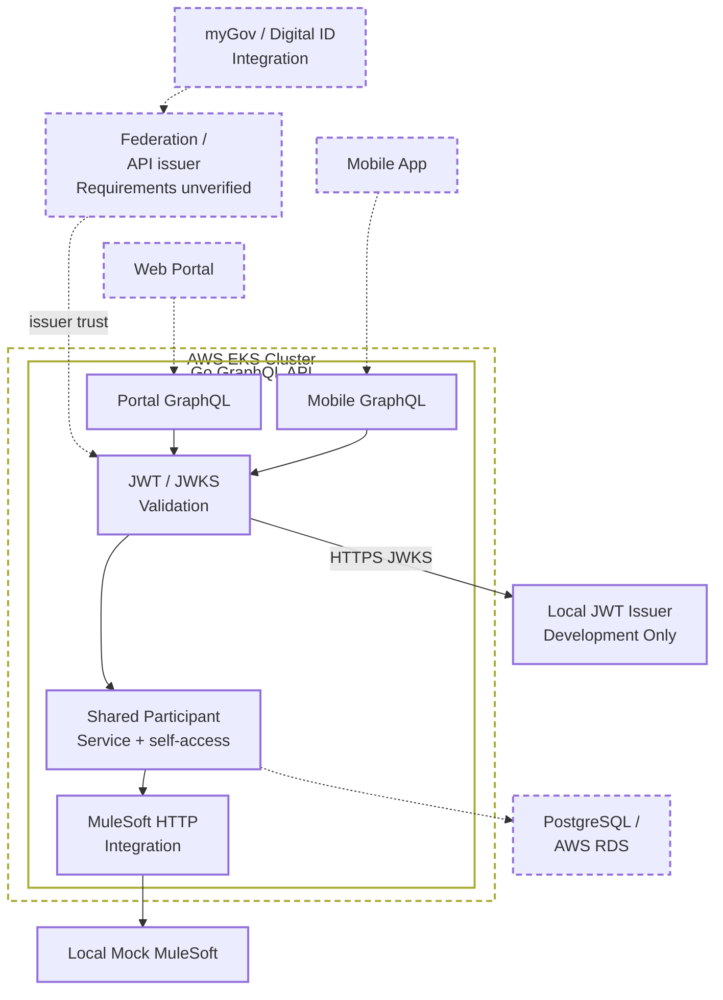

# Participant Services

[Project TODO](TODO.md) · [Detailed architectural roadmap](docs/roadmap.md) · [Development Journal](docs/development-journal.md)

A focused Go/GraphQL reference implementation exploring authenticated APIs, participant self-access, shared application services and resilient HTTP integration. It uses synthetic data and a mock enterprise backend.

Independently developed as a reference implementation to explore maintainable software architecture, secure API integration, transparent engineering decisions and incremental AI-assisted development. This is a demonstration project using synthetic data, not a production system or an endorsed solution for any organisation. The complete chronological development history remains available.

## Architecture at a glance



**Legend:** Solid border/connections: implemented and locally verified. Dashed border/connections: planned or not yet demonstrated.

This diagram combines the current reference implementation with a proposed future architecture; it is not a verified representation of NDIA's internal systems. The dashed AWS EKS boundary shows intended hosting, not an existing cluster. Kubernetes manifests exist and local kind deployment/API checks passed on 28–29 October 2026; no AWS deployment or currently running cluster was verified for this update. See [Kubernetes evidence](docs/testing.md#kubernetes-verification).

The myGov / Digital ID integration and federation/API issuer are conceptual: OAuth 2.0 / OpenID Connect are potential technologies, subject to verification of actual integration requirements. No internal identity provider or direct issuance of API JWTs by myGov is assumed. The API currently validates tokens against a configured issuer and HTTPS JWKS; the local issuer is development-only, not production-ready.

Self-access authorisation is enforced in the shared service. PostgreSQL/RDS is a separate future persistence capability alongside MuleSoft integration, not a replacement.

See [Architecture and Design](DESIGN.md) and the [Project TODO](TODO.md) for details and planned work.

## What it demonstrates

- Separate Portal and Mobile GraphQL contracts over one participant service.
- RS256 JWT validation through trusted HTTPS JWKS, key caching and rotation handling.
- Shared-service self-access using a signed participant mapping, with cross-participant denial before upstream calls.
- A MuleSoft-style HTTP adapter and local mock, cancellation, bounded retries and request correlation.
- JSON logging, health/readiness probes and graceful HTTP shutdown.
- Local Docker/kind demonstrations, reproducible tests and credential-free CI image builds.
- Incremental [AI-assisted engineering](docs/ai-assisted-engineering.md) with reviewable changes and an append-only development audit.

The reference slice is intentionally small: retrieve a synthetic participant through two consumer contracts. It is an example to understand and adapt, not a complete participant platform or production security template.

## Quick start

Follow the [first-time local setup](docs/containers.md#first-time-local-setup), then run the [token-safe authentication and authorisation check](docs/testing.md#local-authentication-smoke-check). The guide includes prerequisites, certificates, configuration, startup, renewal and shutdown. Docker supplies the Go toolchain; host Go is optional for that path.

With Go 1.27.3 installed, tests run without an external identity provider:

```bash
go test -count=1 -race ./...
go vet ./...
python3 scripts/check_docs.py
```

**Choose the correct entry point:** `go run ./cmd/api` serves the protected participant API and requires JWT configuration. Root `server.go` is a separate legacy Todo tutorial: it is unauthenticated, has unsynchronised mutable state and must not be exposed publicly. See the [native Go alternative](docs/containers.md#native-go-alternative) for an existing provider.

## Scope and verification

Participant self-access is merged via [PR #1](https://github.com/shawfire/participant-services/pull/1). [Merged-main CI](https://github.com/shawfire/participant-services/actions/runs/40831913830) passed; local Docker/kind checks are recorded in [testing](docs/testing.md). Publication-preparation checks are recorded in [testing](docs/testing.md#publication-preparation--30-october-2026); current hosted results belong to the commit being reviewed.

Staff/delegate policies, entitlement provisioning/revocation, production identity operations, query/rate limits, persistence and production traffic management remain outside this implementation. AWS/EKS and managed-secrets integration are proposed, not deployed. CI does not run the complete container onboarding flow, and no full clean-checkout onboarding result is claimed.

The local issuer is an unauthenticated development fixture that reuses its TLS key for signing. Its Compose health probe skips TLS verification; the API's Go JWKS client validates TLS. These limitations and further deployment gaps are documented in [security guidance](SECURITY.md) and the [roadmap](docs/roadmap.md). Keep the demonstration local and use synthetic data only.

## Documentation and contribution

Start with the [documentation index](docs/README.md), [architecture](DESIGN.md), or [engineering approach](docs/ai-assisted-engineering.md). The [journal](docs/development-journal.md) preserves chronological steps, failed attempts, corrections and evidence; [documentation changes](docs/documentation-changelog.md) and [original snapshots](docs/history/README.md) provide supporting history. Historical claims describe their recorded stage, not necessarily the current system.

Propose focused changes through a pull request, explain the problem and scope, and include actual verification results. Human review is required before accepting AI-assisted work. Report vulnerabilities privately as described in [SECURITY.md](SECURITY.md), rather than in public issues or pull requests.

Project-authored material is available under the [MIT licence](LICENSE); [third-party notices](THIRD_PARTY_NOTICES.md) retain upstream attribution. Never commit real participant information, access tokens, private keys or confidential material.
