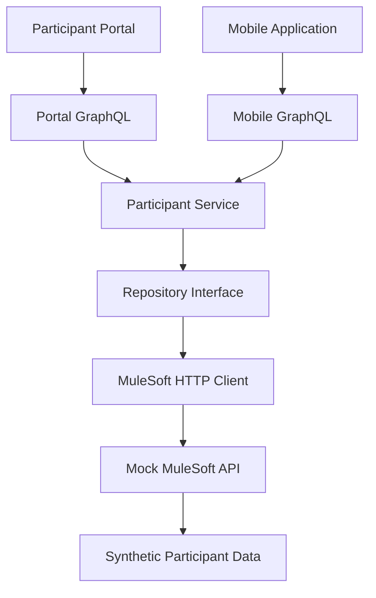

# MuleSoft integration

[Documentation index](README.md) · [Architecture](../DESIGN.md)

Adapter and resilience — implemented

**Status:** Implemented and verified locally on 27 October 2026.

### Architecture

The Portal and Mobile GraphQL APIs share a Participant Service that retrieves data through a repository interface and MuleSoft HTTP client.

### Component responsibilities

| Component | Responsibility |
|---|---|
| Portal GraphQL | Portal-specific participant schema |
| Mobile GraphQL | Mobile-specific profile schema |
| Participant Service | Shared application service |
| Repository interface | Dependency inversion and data access contract |
| MuleSoft HTTP client | External HTTP integration |
| Mock MuleSoft API | Simulated enterprise backend |
| Synthetic data | Test participant records |

### Dependency injection

The Participant Service supports an injected repository through `NewServiceWithRepository(repository)`.

The MuleSoft HTTP client implements `participant.Repository`.

The original `NewService()` constructor remains available for in-memory tests.

### HTTP resilience

Implemented:

- Configurable HTTP client timeout.
- Request context propagation and cancellation.
- HTTP 404 mapped to the domain not-found error.
- HTTP 5xx mapped to an upstream error.
- Network failure propagation.
- JSON response decoding.

Planned: circuit breaking, idempotency for future submissions, metrics and distributed tracing. Bounded retries are implemented below. API authentication, logging and lifecycle readiness have their own references; upstream authentication and participant authorisation remain future work.

### Runtime configuration

- GraphQL API: `localhost:8080`
- Mock MuleSoft API: `localhost:8081`
- Upstream configuration: `MULESOFT_URL`

### Verification

See [testing](testing.md) for coverage, recorded results and evidence limits. Historical outcomes remain in the [development journal](development-journal.md).

### Architectural trade-offs

The Participant Service currently supports both in-memory data and an injected repository. This preserves compatibility but mixes two data-access strategies.

A future refactor should move the in-memory implementation into a dedicated repository adapter.

The MuleSoft API is simulated. No actual NDIA, MuleSoft or Salesforce systems are connected.

### Bounded retries and exponential backoff

**Status:** Implemented and verified locally on 27 October 2026.

The MuleSoft HTTP client supports three total GET attempts, with retry delays derived from the named constant `initialRetryDelay` (100 ms followed by 200 ms).

- Retry HTTP 502, 503 and 504, plus eligible network failures.
- Do not retry HTTP 404, other non-retryable responses or client timeout errors.
- Stop when the request context is cancelled, including during backoff.
- Preserve the shared Participant Service and existing GraphQL schemas.

Automated tests verify recovery after transient failures, the maximum attempt count, no retry for HTTP 404, and cancellation during backoff.

Verification evidence is recorded in [testing](testing.md).

**Production improvements planned:** jitter, `Retry-After` handling, an overall retry budget, configurable policies and retry metrics.

The API sets a two-second HTTP client timeout per attempt, not an overall retry budget. Run the mock with `go run ./cmd/mockmulesoft`; it serves `GET /api/participants/{id}` on port 8081 with P001 (Alex Taylor) and P002 (Jordan Lee). Unknown IDs return 404. There is no separate Salesforce mock service. See [testing](testing.md) for coverage and [observability](observability.md) for correlation.
